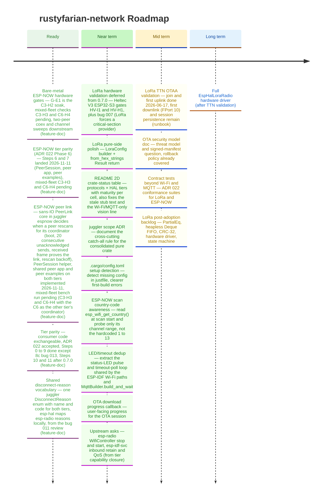

# Roadmap

*Last updated: November 2026*

## Context

Both tiers run the September 2026 stack.
The bare-metal tier pins `esp-hal 1.2.2` and `esp-radio 1.0.0-beta.1`, a pre-release to re-pin to `1.0.0` when it ships.
The ESP-IDF tier pins `esp-idf-svc 0.53` and `esp-idf-hal 0.47`.
Tier parity (ADR 022) is the primary API goal, with both tiers on shared `juggler` cores.
For history, see `CHANGELOG.md` and `docs/features/archive/`.

## Forward plan

---

## Code deep-dive findings (June 2026, re-checked 2026-11-11)

The June review covered all crates before the juggler consolidation.
The rows were re-checked against the code on 2026-11-11 with the resolved ones removed.

|  # | Area                | Finding                                                                                     | Tracked                                                    |
|---:|:--------------------|:--------------------------------------------------------------------------------------------|:-----------------------------------------------------------|
|  1 | README              | The README vision line still says only Wi-Fi and MQTT; the stub wording is gone.            | Near term (folded into 2D crate-status table)              |
|  3 | esp-idf wifi + mqtt | The status-LED pulse and timeout-poll loop exist three times: the WiFiManager LED path, its poll loop and `MqttBuilder::build_and_wait`. | Near term (LED/timeout dedup) |
|  7 | espnow-pure         | Both drivers build events with `EspNowEvent::try_new`, which never truncates; the public `EspNowEvent::new` still panics in debug and truncates in release, so deprecate it. | Hygiene batch |
|  9 | lora-pure           | juggler's `LorawanDevice::process()` still returns `NoUpdate` (the `PhyRxTx` bridge is unwired); the hardware-proven join path is `LorawanTimeline` plus `lorawan-device` in the ESP-IDF join example, so the wrapper is either wired or retired. | Mid term (LoRa, with the deferred hardware validation) |
| 10 | Pure layer          | Five juggler modules still return `&'static str` errors (wifi, provisioning boot and ssid, mqtt host and subscriptions) beside concrete enums and `LorawanError<E>`. | Near term (folded into pure-scope ADR)                     |

Positive findings worth keeping in mind (no action):

- `rustyfarian-esp-hal-network` OTA module's hand-rolled HTTP/1.1 parser is the security high-water mark (33 tests covering RFC 7230 smuggling vectors).
- MQTT's SUBACK-deadlock avoidance (resolved via `MqttBuilder::subscribe`) and its `Weak`-based event-loop shutdown are solid.
- ESP-NOW's failed-scan recovery keeps the last known channel by design; since ADR 025 a stale pin is corrected by the coordinator's probe reply on the next scan, and PeerLink rescans after 20 unacknowledged sends.

---

## Midterm detail

Phase 5 TTN v3 EU868 OTAA validation checklist: [runbooks/ttn-otaa-validation.md](runbooks/ttn-otaa-validation.md).

### Research

| # | Item                                                                                                                       |
|--:|:---------------------------------------------------------------------------------------------------------------------------|
| 1 | Evaluate ESP-IDF v5.5.5 — contains the v5.5.2 fix for "ESP-NOW send failure when coexistence is enabled"; requested by a downstream project, see `docs/features/esp-idf-v5-5-upgrade-v1.md` |

### LoRa post-adoption backlog

<strong>Deferred items from initial adoption</strong>

Items #1 (builder) and #2 (`from_hex_strings` Result) promoted to Near term on 2026-05-06.

| # | Item                                                                              |
|--:|:----------------------------------------------------------------------------------|
| 4 | `PartialEq` on `LorawanResponse` / `Downlink`                                     |
| 5 | Replace manual O(n) FIFO shift in `MockLoraRadio::receive` with `heapless::Deque` |
| 6 | Implement CRC-32 integrity check in `restore_from_sleep` (Phase 7)                |
| 7 | Implement `EspHalLoraRadio` hardware driver (Phase 2-4 milestones)                |
| 8 | Wire `LorawanDevice::process()` state machine to `lorawan-device 0.12`            |

