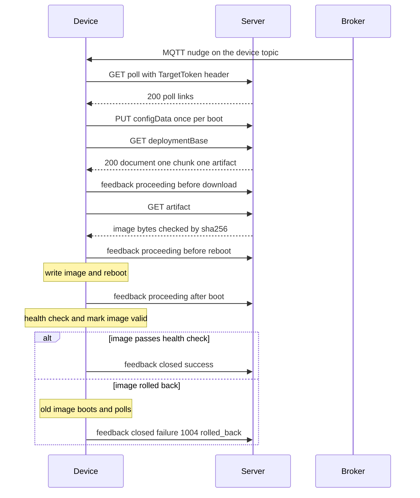
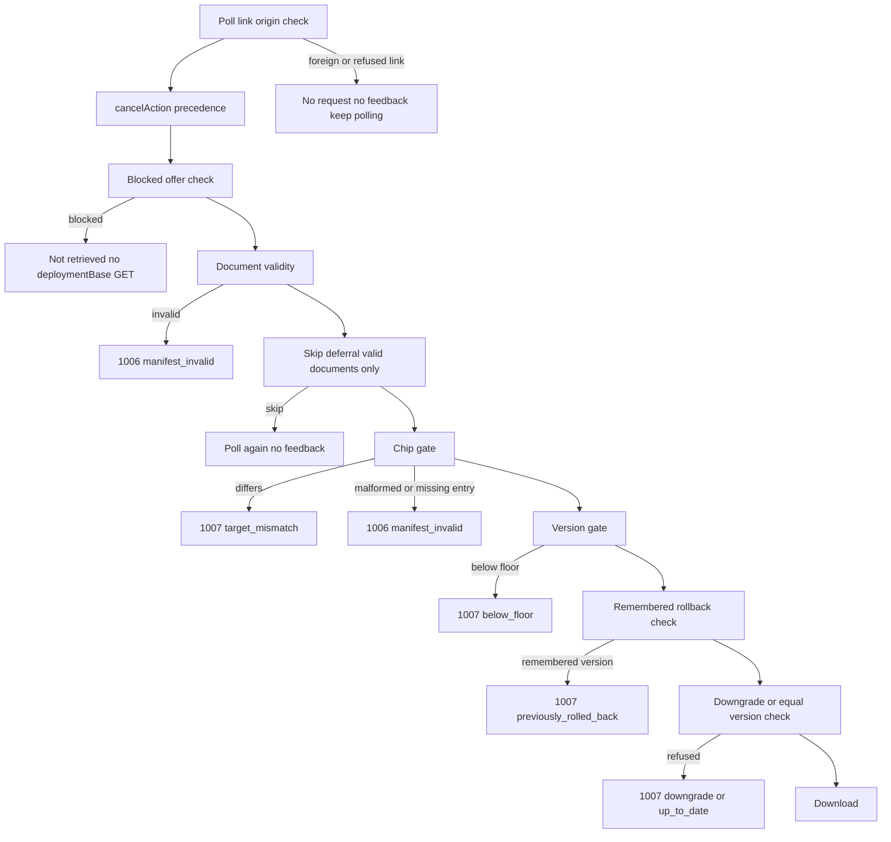

# Feature: DDI OTA client v1

The fleet backend chose a profile of the Eclipse hawkBit DDI API v1 as its device-facing OTA wire.
The device polls over HTTP with a per-device `Authorization: TargetToken <token>` header, and an optional MQTT nudge wakes it early.
The profile is fleet DDI profile 0.4.0, frozen on 2026-11-21.
A change to its hashed region (§1 to §6, the §7 pass criteria and the declared divergences) is a MINOR bump, and the fleet relays every bump here.
Status: the ESP-IDF and esp-hal clients are done over plain HTTP behind a lab opt-in, the TLS round is open, and this transient doc is archived when the feature closes.

## Problem

Until 2026-11-24 the OTA runtime spoke the MQTT wire (ADR 018), and both tiers downloaded with internal HTTP GET clients that are not a public API.
The fleet needs a device-facing HTTP polling client with TLS, origin-bound credentials and fail-closed update rules.
Neither tier had that: the ESP-IDF tier had a downloader but no DDI transport, and the esp-hal tier had no TLS, no DNS on the OTA path and no OTA runtime.
The ESP-IDF tier came first; the esp-hal round followed on 2026-11-24.

## How it works

### Update sequence

- The diagram shows one update; the `configData` PUT happens at the first poll of each boot that returns 200, whether or not that poll carried a link.
- A poll without a `deploymentBase` link sends no GET.
- The post-boot `proceeding` is a profile SHOULD that resets the server's silent timeout during the longest gap.
- A nudge polls no sooner than 10 s after the last poll started, and never during a poll in flight.

### Offer evaluation order

- The early image-header chip check is not in this chart; it reads the first bytes received and refuses a mismatch as 1007 before any flash write.
- The fixed order means an invalid, mislabelled document gets 1006 on both sides.
- The downgrade marker and refusal precedence are under Update behaviour.

## Decisions

The maintainer decided each decision on 2026-11-20, and rows that cite profile 0.4.0 were aligned on 2026-11-22.

### Scope and ownership

| Decision | Reason | Rejected Alternative |
|:--|:--|:--|
| Sans-IO DDI state machine in `juggler`, plus a credential-bound transport per tier | Host-tested; time and random values are inputs, as in `DownloadMachine` | Generic GET, POST, PUT primitives |
| No generic HTTP API is exported | `README.md:35-37` keeps general HTTP clients out of scope | Exporting a reusable HTTP client |
| ESP-IDF first; esp-hal followed 2026-11-24, gaps in [esp-hal tier gaps](#esp-hal-tier-gaps-adr-022) | Fleet devices run ESP-IDF; juggler machines are tier-neutral | Both tiers in the first release |
| MQTT OTA wire and runtime (ADR 018) removed, unreleased | Deprecated 0.8.0, removed 2026-11-24; no build accepts an MQTT OTA command | Keep the MQTT wire long term |
| DDI client in 0.8.0 under the plain-HTTP lab opt-in; TLS later | Lets the fleet start while TLS lands; not documented as ready outside a lab before TLS | 0.8.0 waits for TLS |

### esp-hal tier gaps (ADR 022)

The esp-hal round keeps the ESP-IDF names as `async fn`, but these differences go beyond the error type.
Consumer code that targets both tiers must allow for them.

- `DdiRuntime::start(records, stack)` also takes the station `Stack` and returns `(DdiHandle, DdiRunner)`; the firmware spawns `DdiRunner::run`.
- ESP-IDF `start(records)` returns `DdiHandle` and starts its own threads.
- `RestartFn` is a plain `fn()`, where ESP-IDF takes `Arc<dyn Fn() + Send + Sync>`, so a capturing closure does not compile on esp-hal.
- `open_records` takes the `&'static SharedFlash` from `SharedFlash::new(peripherals.FLASH)`, where ESP-IDF takes an `EspDefaultNvsPartition`.
- Records are a `FlashKv` log in the `nvs` data partition; the ESP-IDF tier keeps them in NVS and is unchanged.
- A lost record makes the next offered action report `closed` + `failure` + 1005 `records_unreadable` instead of being applied.
- The store keeps that finding across reboots until the 1005 verdict is stored.
- The DDI download always checks the image header chip against `TARGET_CHIP`, because bare-metal slot activation does not read the header.
- `EspHalOtaManager` has no `with_expected_chip`; the ESP-IDF `OtaSession` keeps it as an opt-in.
- After a download selected its slot for the next boot, every later download of that boot fails with `FlashBusy` until the reset.
- The partition table needs two OTA slots: a factory image with one OTA slot is refused at `start` with `PartitionNotFound`, before any update.
- No IPv6 server address: a bracketed host is `ServerUnreachable`.
- DNS is A-record only on the DDI path, through `Stack::dns_query`; IPv4 literals are used as is.
- No wall clock: feedback carries no timestamp, and a `Retry-After` date is ignored (a delay in seconds still applies).
- No TLS, as on ESP-IDF: `https://` is refused with `TlsUnavailable`, and `http://` works only under `ota-ddi-insecure-http`.
- `DdiHandle::stack_high_water` always returns `None` for both marks, since the worker and the download share one task.
- `ota-ddi` turns on `embassy-net` DNS and raises `wifi::STA_SOCKET_COUNT`, so firmware that sizes `StackResources` by hand must use the constant.
- `with_deadline` needs `ota-ddi` on `EspHalOtaManager`; on `OtaSession` it is ungated, and it and `with_expected_chip` have no effect without `ota-ddi`.

### Undelivered `rolled_back` report

- A `rolled_back` report that the removed MQTT OTA runtime left undelivered keeps every DDI offer blocked (`unbound_report_blocks`), and the boot warning says so.
- Only `OtaStore::mark_report_delivered` clears it, and its last caller was the MQTT OTA runtime of release 0.8.x, which ran on ESP-IDF only.
- Recovery on ESP-IDF: flash a release 0.8.x MQTT OTA image once so that it delivers the report, or erase the OTA records (the `ota` NVS namespace).
- Recovery on esp-hal: the records are a `FlashKv` log that no released MQTT OTA image reads, so erasing is the only option.
- `just erase-flash` erases the records on both tiers, together with everything else in flash.

### Transport and security

| Decision | Reason | Rejected Alternative |
|:--|:--|:--|
| HTTPS only in release images; `http://` only behind `ota-ddi-insecure-http` | Release devices must not accept plain HTTP; the opt-in WARNs once per boot | A runtime config flag |
| One trust anchor fixed at image build; clock gate before every TLS connect | The CA must not be writable from the portal; certificate validity needs a sane clock | CA in NVS; a public CA bundle |
| Origin binding: the transport builds every request and checks each link against the base origin | A foreign artifact URL or 3xx gives 1006 `foreign_origin` or `redirect`; a foreign poll link is ignored | Following server URLs unchecked |
| Redirects are never followed; `FollowRedirectsPolicy::FollowNone` is set | esp-idf-svc's default follows GET redirects and keeps the token header | Follow redirects |
| Token lives in a redacting `Secret`; release-image settings keep it out of logs and dumps | `esp_http_client` logs the `Authorization` header at DEBUG | Plain `String` fields |

Transport and security details

**Trust anchor (profile 0.4.0 §1).**

- Exactly one trust anchor is fixed at image build, as one CA certificate or one pinned server key; the compiled-in CA is that choice.
- No provisioning or runtime input can change it.
- Hostname verification and TLS 1.2 or later are required.
- There is never a fallback to plain HTTP.

**Wall-clock gate (S2).**

- The clock must be set and at or after `WALL_CLOCK_FLOOR_SECS` (2024-01-01) before every TLS connect.
- Reconnects are included, because the client does no `Range` resumes.
- A failed check fails closed with the library's own error, and that error has no wire code.
- Before an offer is retrieved nothing is sent, and the device polls again once the clock passes.
- Inside an action it is a connection failure that becomes 1001 once the download deadline passes.
- One WARN names the case, at most once per boot until the check passes (profile 0.4.0 §1, §4).
- The app starts SNTP.
- Until S2 lands, `https://` is refused with `TlsUnavailable`, and `WALL_CLOCK_FLOOR_SECS` gates timestamps only.

**URL grammar (profile 0.4.0 §2, plus two stricter rules).**

- The accepted form is `scheme://host[:port]` followed by `/`, `?` or the end.
- The host is a DNS name of `[A-Za-z0-9-]` labels with a letter in the last label, a canonical IPv4, or a bracketed IPv6.
- `@`, `\`, `%`, whitespace, control characters and non-ASCII are refused anywhere.
- Scheme and host are lower-cased, and the default port is made explicit.
- A last host label that is a number in any base is no DNS name, and a `.` or `..` path segment is refused.
- Requests go only to the `CheckedUrl` rebuilt from the checked parts.
- A refusal is logged as a WARN naming the `UrlRefusal` case (`forbidden_char`, `syntax`, `scheme`, `host`, `port`, `origin`, `length`, `path`), never the URL.
- `DdiEndpoint::check_base_url` is the exposed validator.

**HTTPS acceptance (S1 to S4, profile 0.4.0 §7 HTTPS).**

- The list is checked on the image a device runs, on that chip's hardware.
- Over `https://`, a poll, a deployment, its feedback and the image download succeed.
- The image contains no `http://` opt-in, and the release-image settings are checked on the image.
- A failed clock check, a wrong CA, a wrong hostname, an expired certificate and a foreign-origin link each fail closed with no `http://` connection.
- A trust anchor or `http` opt-in supplied through provisioning is ignored.
- `mqtts://` with CA verification is used for the nudge.
- A change to this list is relayed to the fleet.

**Release-image settings (profile 0.4.0 §2).**

- `CONFIG_LOG_MAXIMUM_LEVEL` stays at INFO or below.
- `CONFIG_MBEDTLS_DEBUG` stays off.
- `CONFIG_ESP_COREDUMP_ENABLE_TO_UART` stays off, so no core dump goes to UART.
- `CONFIG_ESP_SYSTEM_PANIC_GDBSTUB` stays off, so there is no panic GDB stub.
- A release image is any build not made solely for the bench, lab-fleet builds included.
- Profile 0.4.0 §2 supersedes the fleet's FR-A and FR-B debug-log promises, which are closed by these settings.

**Limits, nudge and logging.**

- JSON bodies are bounded at 4 KiB request and 8 KiB response, and buffered on the heap.
- `url_for_log` strips userinfo, query and fragment, since the query can carry secrets.
- `mqtts://` with the compiled-in CA is used for the nudge.

### Provisioning and identity

| Decision | Reason | Rejected Alternative |
|:--|:--|:--|
| Device id grammar `^[a-z0-9][a-z0-9-]{2,19}$`, equal to controller id, MQTT username and client id | One identity for all three uses | Separate names per service |
| `IdentityRule::{Open, Ddi}` as a runtime option on both tiers, Wi-Fi+MQTT only | One id, enforced at the portal; the open rule keeps old consumers | Compile-time only |
| Token is the extra `ddi_token` (`x_ddi_token` in NVS), grammar `[0-9a-f]{32,64}` | CR and LF never reach a header; the grammar is shared with `DdiToken::parse` | A dedicated portal field |
| Token storage encrypted in a release image; plaintext NVS only in a lab-board build | The library store is plaintext NVS; encryption is the device image's concern | Encrypt in this library |
| No provisioned DDI base URL this round; examples keep `DDI_BASE_URL` | `check_base_url` needs alloc, which the no-alloc esp-hal store lacks | A `ddi_base_url` extra, ESP-IDF only |

**Identity rule.**

- Defaults: `Ddi` on ESP-IDF when `ota-ddi` is on, `Open` otherwise; esp-hal defaults to `Open`.
- The rule binds the Wi-Fi+MQTT profile only; a LoRaWAN portal and the Wi-Fi-only fallback run as `Open`.
- Under `Ddi`, the device name must be a device id, `mqtt_user` must equal it, and `mqtt_client` must be blank or equal it, checked at submit.
- Under `Ddi`, a bad `MacSuffixed` prefix or `Fixed` name is refused when the portal is planned (`PortalPlanError::InvalidDeviceName`).
- Under `Open`, truncation stays.
- A fresh form pre-fills `mqtt_user` from the device name, with `mqtt_client` blank.

**Token handling.**

- The token is validated whenever the `ddi_token` extra is present, and it is required under `Ddi`.
- It is re-entered on every full submission like the passwords; the Wi-Fi-only fallback form keeps the stored one.
- `ProvisioningConfig::ddi_token()` validates it again before use.
- `EXTRA_VALUE_MAX_LEN` is 64 and is never lowered below 64 within 0.x, so the token fits.
- The input has no value under `Ddi` and nothing under `Open`, and the token is never echoed into HTML, the status JSON or logs.

### Update behaviour

| Decision | Reason | Rejected Alternative |
|:--|:--|:--|
| Offer evaluation order per the flowchart: document rules, skip, chip gate | Both sides report the same code for an invalid, mislabelled document | Check the chip before document validity |
| Version rules: downgrade marker, device floor, remembered rollback, refusal precedence | One refusal code per offer, in a fixed order | The server decides any version |
| Blocked offers (pending verification, open attempt, undelivered report) are not retrieved | No `deploymentBase` GET, so the silent timeout never starts | Retrieve and queue |
| Poll statuses and download retry: transient errors retry, terminal 1001 only after the deadline | A poll failure must not end an action, nor one 503 a download | Fail on the first error |
| Cancel is acknowledged until activation, rejected after | An operator emergency stop for the whole download | Reject every cancel while an attempt is open |

Update behaviour details

**Document rules (profile §3a).**

- A document must have exactly one chunk with exactly one artifact.
- A chunk with `encrypted: true` is refused.
- A missing or malformed `size` or `hashes.sha256` is refused, and so is a missing `download-http` link.
- A `size` above the update partition is refused with 1006 before download.
- The 8 KiB response cap is part of document validity.

**Chip gate (profile §3b).**

- A missing, duplicate, empty or malformed `chip` entry is 1006 `manifest_invalid`.
- No metadata entry, the downgrade marker included, overrides this gate.
- The `chip` entry matches `[a-z0-9]{1,32}` and must equal `TARGET_CHIP`; differing is 1007 `target_mismatch`.
- The early image-header check refuses a mismatch as 1007 before any flash write; `esp_ota_end` is the backstop, reported as 1003.

**Skip.**

- Skip applies only to an otherwise valid document; an invalid one is 1006 regardless.
- A value outside `skip`, `attempt` or `forced` is 1006 `manifest_invalid`.
- A `skip` retrieval does not start the server's silent timeout.
- The profile says a server MUST NOT send `skip` (§3a, §6).

**Downgrade marker.**

- The marker must be key `downgrade` with value `allowed`, exactly and case-sensitive.
- Any other value, or a second `downgrade` entry, is 1006 `manifest_invalid`.
- The `previously_rolled_back` refusal runs before the downgrade branch, and it lifts when a different version passes its health check, unless the marker is present.
- When both apply, `previously_rolled_back` wins in `details[0]`, including when the offer is newer than the remembered version.
- With the marker, `closed` + `success` carries `downgrade` or `previously_rolled_back` in `details[0]`.

**Version rules.**

- `Version::parse` accepts only plain decimal `MAJOR.MINOR.PATCH`, with no sign, leading zeros or whitespace, and each part at most 65535.
- An older offer needs `downgrade=allowed`, and an equal one without it is 1007 `up_to_date`.
- The device minimum-version floor refuses below it with 1007 `below_floor`, marker or not.
- Refusal precedence is `below_floor`, then `previously_rolled_back`, then `downgrade` or `up_to_date`.

**Poll status handling (profile 0.4.0 §4).**

- `config.polling.sleep` is clamped to [30 s, 24 h], with the same bounds for `Retry-After` and back-off; 24 h is library policy, and the profile sets the 30 s floor.
- 410 stops polling, and 404 re-polls.
- 401 backs off like a transient failure, never with another credential, and still feeds the consecutive-401 rule.
- 413 and 429 honour `Retry-After`.
- 429 without `Retry-After`, 5xx and timeouts back off exponentially from the poll interval up to 24 h, with jitter.

**Download retry.**

- Inside an action, an unreachable server, a timeout, a body cut short, or a status 0, 408, 413, 429 or 5xx is retried.
- The wait is 5 s, doubling to 60 s, or the answer's `Retry-After` if longer; the last wait is clamped to the deadline.
- Each attempt starts a new session (`decide_download_retry`).
- The download deadline default is 300 s (see Open Questions).
- On the esp-hal shared flash a cancel and the deadline are also checked before each erased sector.
- An artifact `size` that differs from `Content-Length` or the bytes written is 1001 `size_mismatch`.
- `OtaError::FlashBusy` (`flash_busy`) retries until the deadline, and still busy then gives `Flash` 1003.

### Feedback, nudge and conformance

| Decision | Reason | Rejected Alternative |
|:--|:--|:--|
| Persisted loop guard (`ddi_act`, `ddi_stage`) and verdicts; a pending verdict wins | Closed actions never rerun after reboot; no power loss clears an attempt without its verdict | Keep the action in RAM; newest verdict replaces pending |
| Terminal feedback retried until the server answers 200, 404 or 410, no faster than 30 s | Only `rolled_back` was persisted before; `applied` is best-effort | Best-effort feedback |
| Feedback sequence per the sequence diagram; rollback reported as 1004 `rolled_back` at boot | The old image sends it, which beats the server's silent timeout | A single final report |
| Nudge topic `rustyfarian/ota/<device-id>/nudge`, re-subscribed on every connect | Survives reconnects; no poll sooner than 10 s after the last poll started, never mid-poll | Subscribe once; trust the server's rate |
| Conformance: the profile §7 device-scenario list is the contract | The shared list is the contract, and this repo catches drift | Fleet-only tests |

The harness differences F1 to F7 and the rows that do not run on the host are tabled in the header of `crates/juggler/src/ota/ddi/scenarios.rs`.

Feedback, nudge and conformance details

**Verdict persistence.**

- Every verdict of an attempt is written inside the store's own sequence before the attempt is cleared, and is sent only once the attempt is gone.
- An attempt cleared without its version having booted (an interrupted download, or a slot marked invalid) writes no verdict, and the action is offered again.
- An attempt that booted with app rollback disabled reports success.
- A `records_unreadable` verdict repairs the corrupt records first.
- Boot repair runs when corruption closes admission, and it reports 1005 only when it dropped records or could not finish.
- A transient read error repairs nothing and reports nothing.
- `ddi_act` holds the action id in canonical `i64` form: 1 to 19 ASCII digits, no leading zero unless the id is `0`, and at most `i64::MAX`.
- A verdict counts as delivered on 200, 404 or 410 only, and another 2xx is retried.
- After a 404 the action is gone.
- Corruption fails closed, and boot repair reports `closed` + `failure` + 1005 `records_unreadable`.
- A pending verdict wins; a verdict for another action gets `StoreError::VerdictPending`.

**Feedback limits.**

- After 3 consecutive 401 answers to feedback, retries stop for that action until a poll is not a 401; the verdict is kept and it logs once.
- The bounded feedback encoder sends at most 10 details of 256 characters.
- `details[0]` carries the `FailReason` string; `version_invalid` is 1005, `download_failed` status 0 is 1001, and `insufficient_space` is 1003.
- Thread stack defaults were chosen after measuring an mbedTLS handshake (`StackMarks`), and `DdiStacks` is 16 KiB each, provisional until S4.

**configData.**

- One PUT is sent at the first poll of the boot that returns 200, whether or not that poll carried a link.
- The URL is built from the configured base, with `mode: merge`.
- The keys are only `chip` (grammar in the chip gate bullets), `board` (`[a-z0-9._-]{1,32}`, fixed when the image is built, never provisioned) and `version` (strict version format).
- No other key is sent (profile §3b).

## Constraints

- The fleet DDI profile is frozen at 0.4.0 (2026-11-21), the fleet relays every MINOR bump here, and decisions here follow it.
- The profile version bumps MINOR whenever its §1 to §6, its §7 pass criteria or its declared divergences change, and the freeze keeps the number.
- Rollout evidence may claim HTTPS only after every token and MQTT password used over plaintext has been rotated.
- Tier parity (ADR 022): the same API names and arguments on both tiers, with only the error type differing; the esp-hal gaps are under [esp-hal tier gaps](#esp-hal-tier-gaps-adr-022).
- The first round's DDI transport is blocking on ESP-IDF, and the esp-hal round lands the same names as `async fn` and revisits the blocking choice (ADR 027).
- No reusable, exported HTTP client (`README.md:35-37`).
- Image signature verification is out of scope (device-repo work), so sha256 detects corruption only.
- Residual clock risk: unauthenticated SNTP can still be pushed back to any time after the build date, so the build-time floor is not a hard guarantee.
- Plaintext NVS for the token is a lab-board build only, and a release image keeps it in encrypted storage that the device repo's image provides (profile 0.4.0 §2).
- Release images must not raise `CONFIG_LOG_MAXIMUM_LEVEL` above INFO, enable `CONFIG_MBEDTLS_DEBUG`, write a core dump to UART or run a panic GDB stub.

## Open Questions

- [ ] esp-hal TLS stack choice and when it starts.
- [ ] Heap headroom with one HTTPS and one MQTTS session on C3 and C6 (hardware measurement); over plain HTTP the esp-hal C3 kept about 17 KB of its 72 KiB heap free during downloads.
- [ ] Worker and reporter stack defaults under TLS (after measurement).
- [x] esp-hal chip check: slot activation does not check the image header chip, so the DDI download forces `ImageChip::from_target(TARGET_CHIP)` before any flash write.
- [x] Name and wire code of the clock-not-set error: no wire code (profile §1, §4); the name is the library's choice when S2 lands, after T14 makes `OtaError` `#[non_exhaustive]`.
- [x] The fleet operator confirmed the downgrade marker rule (`downgrade=allowed`) in profile draft 0.3.0.
- [ ] Host-binary interface for the conformance harness (stdio or local HTTP) is open on both sides, and no device-conformance tier runs one yet.
- [ ] The download deadline against the fleet's silent timeout T (profile 0.4.0 §6, default 600 s): does the library cap it, or do device repos keep it below T?
  - `DdiSettings::validate` refuses a zero `firmware_deadline` but sets no upper bound; the default is 300 s.
- [ ] Does the profile require a boot-repair marker that survives a restart (harness difference F5)? Asked the fleet on 2026-11-23, no answer recorded.
  - The 1005 report is held in RAM only (`unreported_corruption`, IDF worker) and goes to the first action offered in that boot.
  - Corruption repaired while no rollout is open is therefore never reported.
- [ ] Bug 023: the post-boot `proceeding` is sent once and lost on any failure.
- [ ] Cause of the one-off esp-hal C3 poll stall (2026-11-24, `c3/ddi-hal` step 8).
  - The device logged `[ota] nudge: polling now` and sent no request for over four minutes, with Wi-Fi and MQTT up, then resumed by itself.
  - Log: `bench/c3/logs/hal_c3_ddi-20261124-143202.log`; it did not recur in five further C3 and four C6 runs.
  - A lost timer wake in the embassy/esp-rtos timer queue is the leading, unproven suspicion.
  - The worker machines, runner wake path, record-store lock and transport deadlines were ruled out by code reading only.
  - Four Info diagnostics stay so that a recurrence shows where the request stopped.
- [ ] Does esp-radio touch the `nvs` partition? No corruption was observed in the 2026-11-24 runs.
- [ ] The `hal_c6_ddi` bundle check, named as owed on 2026-11-24, is not recorded as done.
- [ ] The esp-hal runtime logs `[ota] nudge: polling now` for internal wakes without a nudge (cosmetic, no decision recorded).
- [ ] Known limits of the lost-record detection (2026-11-25): accept or close?
  - A commit writes the first word of its snapshot last, so damage anywhere in a committed record is reported; a write cut short is not.
  - A power cut during the write of that one last word is reported without a loss.
  - Foreign data in the region is reported like a lost record, and the first commit erases it.
  - A sector that fails every write blocks all commits, because a retry stays in the same sector so a lost record is always found.
  - The obligation of a boot repair (records dropped, not lost) is still held in RAM only, on both tiers.
  - A power cut between the erase of a damaged next sector and the first recovery commit loses the finding (fourth review, not fixed).
- [ ] After a failed boot of the selected slot the bootloader may keep running the old image while `otadata` still selects the other slot.
  - A download in that state still erases that slot, on purpose: refusing it would block every later update.
  - Only the handoff inside one boot is guarded (a download that selected its slot keeps the flash until the reset).

Code references

- `crates/juggler/src/ota/download.rs:1-6`: sans-IO pattern the DDI machine follows.
- `crates/juggler/src/ota/download.rs:258-279`: Content-Length enforcement against bytes received.
- `crates/juggler/src/ota/error.rs:14`: `OtaError`, `#[non_exhaustive]` since 0.8.0, so the clock variant is additive.
- `crates/juggler/src/ota/deadline.rs:56`: `Deadline::permit_activation`, where cancel is rejected after activation.
- `crates/juggler/src/ota/persist/store.rs:971`: `OtaStore::repair_corrupt`.
- `crates/juggler/src/mqtt/mod.rs:54`: `format_broker_url`, where the scheme is chosen.
- `crates/juggler/src/provisioning/form.rs:87-94`: `ExtraField` redacting `Debug`, the pattern `Secret` follows.
- `crates/juggler/src/provisioning/config.rs:22-26`: the 13-byte extra-name limit.
- `crates/juggler/src/provisioning/kv_store.rs:11-14`: the plaintext NVS store.
- `crates/juggler/src/ota/ddi/feedback.rs`: `VerdictSender`, the DDI path's own feedback pacing.
- `crates/juggler/src/ota/health.rs`: the pure health policy and record upkeep used by the DDI runtime.
- `crates/juggler/src/ota/ddi/settings.rs`: `DdiSettings`, `DdiStacks`, the wall-clock floor and the nudge topic.
- `crates/juggler/src/ota/ddi/endpoint.rs`: `DdiEndpoint`, `CheckedUrl`, `UrlRefusal` and `check_base_url`.
- `crates/juggler/src/ota/ddi/wire/code.rs`: `ProfileCode::for_reason`, the reason-to-code table.
- `crates/juggler/src/ota/persist/tests/flash_kv.rs`: the lost-record host tests.
- `crates/rustyfarian-esp-idf-network/src/ota/ddi/`: the DDI runtime (`worker`, `download`, `handle`, `nudge`).
- `crates/rustyfarian-esp-idf-network/src/ota/downloader.rs:63`: `url_for_log`.
- `crates/rustyfarian-esp-hal-network/src/ota/mod.rs`: `TARGET_CHIP` per chip.

## State

- [x] ADR 027 written
- [x] ADR 018 amendment (feature split and deprecation)
- [x] Feature split: `ota`, and `ota-ddi` for the DDI runtime, which paces its own feedback
- [x] `juggler` DDI state machine
- [x] `Version::parse` tightening
- [x] `url_for_log` change and once-per-boot WARN on the IDF tier
- [x] Portal identity and token provisioning (T10) on both tiers, host tests and checks green
- [ ] Hardware run for portal identity and token provisioning (none recorded)
- [ ] Provisioned DDI base URL (`ddi_base_url` extra checked by `check_base_url`) and examples reading controller id, token and base URL from provisioning
- [x] Cancel input on the download machine
- [x] Persisted terminal verdicts and loop guard
- [x] Early image-header chip check on both tiers (`with_expected_chip`)
- [x] IDF DDI transport
- [x] IDF DDI runtime (`ota::ddi` worker, download thread, health hook, nudge)
- [x] esp-hal DDI client (`ota-ddi`, `hal_c3_ddi`, `hal_c6_ddi`), with the gaps under [esp-hal tier gaps](#esp-hal-tier-gaps-adr-022)
- [x] Post-removal bench 2026-11-24: `c3/ddi-idf`, `c6/ddi-idf`, `c3/ddi-hal` and `c6/ddi-hal` each 20/20 against hawkBit 1.2.0 behind the lab proxy
- [x] Review-fix bench 2026-11-24: `c3/ddi-hal` and `c6/ddi-hal` each 20/20 in two rounds
- [x] Lab DDI server runs: `idf_c3_ddi` and `idf_c6_ddi` each 20/20 on 2026-11-23
- [x] esp-hal DDI poll stall seen once on C3 (2026-11-24): treated as a one-off by maintainer decision, no bug filed, worker sleep unbounded
- [ ] TLS round (S1 to S4): HTTPS with the compiled-in CA, clock gate, `mqtts://` nudge, stack and heap measured on C3 and C6
- [x] MQTT OTA wire and runtime deprecated in 0.8.0 and removed 2026-11-24, unreleased
- [x] Host tests and the conformance scenario list (T12) in `crates/juggler/src/ota/ddi/scenarios.rs`, run by `just test-ota`
- [ ] Bench reject pattern for the DDI token in the serial capture of `c3/ddi-idf`, `c3/ddi-hal` and `c6/ddi-idf`; no bench step checks it yet
- [ ] esp-hal owned-flash path and ESP-IDF tier erase the image span in one blocking call, so a cancel or deadline is seen only after the erase
- [ ] Hardware row for the blank-`otadata` target choice (`ota_0` running) on esp-hal
- [ ] Hardware for the 2026-11-24 review fixes not yet run: two concurrent downloads, a corrupt record, and a cancel during the erase
- [ ] Hardware for the 2026-11-25 lost-record, busy-lease, second-review and third-review changes (none yet)
- [ ] CHANGELOG entries, including the `url_for_log` and `OtaError` breaking changes and the new `OtaError::FlashBusy` variant
- [ ] Documentation updated

## Session Log

Session log

- 2026-11-20 — Doc created from the review of profile draft 0.1.0; scope cut to ESP-IDF first; aligned to draft 0.3.0. Result: decisions recorded.
- 2026-11-21 — ESP-IDF DDI transport, persisted verdicts and loop guard, `ota-ddi` split, ADR 018 amendment. Result: `https://` refused until TLS.
- 2026-11-22 — ESP-IDF DDI runtime, origin check to profile §2, feedback codes to §4, profile 0.4.0 sync. Result: host tests green.
- 2026-11-22 — Portal identity and token provisioning (T10) on both tiers. Result: host tests and checks green, no hardware run.
- 2026-11-22 — Bench checks `c3/ddi-*` and `c6/ddi-*` with operator recipes; a tampered copy exercises 1002. Result: dry run on loopback.
- 2026-11-22 — Device-conformance host tests (T12), one per §7 device row. Result: all green.
- 2026-11-23 — Lab hardware: `idf_c3_ddi` 20/20 on C3 and `idf_c6_ddi` 20/20 on C6. Result: pass.
- 2026-11-23 — FR-B timing review: the post-boot `proceeding` is lost on any failure (bug 023). Result: open.
- 2026-11-24 — esp-hal DDI client implemented (record store in `nvs`, hand-rolled HTTP transport, A-record DNS). Result: `https://` still refused.
- 2026-11-24 — esp-hal C3 run: `idf_c3_ddi` and `hal_c3_ddi` each 20/20 behind the lab proxy at 20 KiB/s. Result: pass; C6 run owed.
- 2026-11-24 — MQTT OTA wire deprecated in 0.8.0 and removed unreleased; `fetch_and_apply*` removed on both tiers. Result: no build accepts an MQTT OTA command.
- 2026-11-24 — esp-hal C3 poll stall at `c3/ddi-hal` step 8 (log `bench/c3/logs/hal_c3_ddi-20261124-143202.log`), four Info diagnostics added. Result: cause not found.
- 2026-11-24 — Post-removal bench: `c3/ddi-idf`, `c6/ddi-idf`, `c3/ddi-hal`, `c6/ddi-hal` each 20/20. Result: pass in four parallel rounds.
- 2026-11-24 — External review of 9cbd443 and 5b95b3c: five findings fixed (esp-hal target, busy lease, `FlashKv` resync, erase checks, shared proxy). Result: verify and lint-docs pass.
- 2026-11-24 — Review-fix bench: `c3/ddi-hal` and `c6/ddi-hal` each 20/20 in two rounds. Result: pass.
- 2026-11-25 — Busy lease made transient; lost-record detection (`FlashKv::newer_record_lost`), esp-hal reports 1005. Result: four host tests, no hardware run.
- 2026-11-25 — Second external review, four findings fixed: slot kept until reset after activation, header-last commits, `otadata` checked before any erase, bench stops only its own proxy. Result: host tests and checks green, no hardware run.
- 2026-11-25 — Third external review, five findings fixed: no sector skipped on a write retry, lost-record finding stored until the 1005 verdict, proxy health path, two OTA slots required, README pin. Result: host tests and checks green, no hardware run.
- 2026-11-25 — Fourth external review: a delivered 1005 verdict now also clears the stored finding; three items left as they are (recovery power-cut window, two proxy ports, README git ref). Result: host tests and checks green, no hardware run.
- 2026-11-25 — Final review round: the worker drops its owed 1005 when a queued 1005 verdict is delivered. Result: host test added, checks green, no hardware run.

